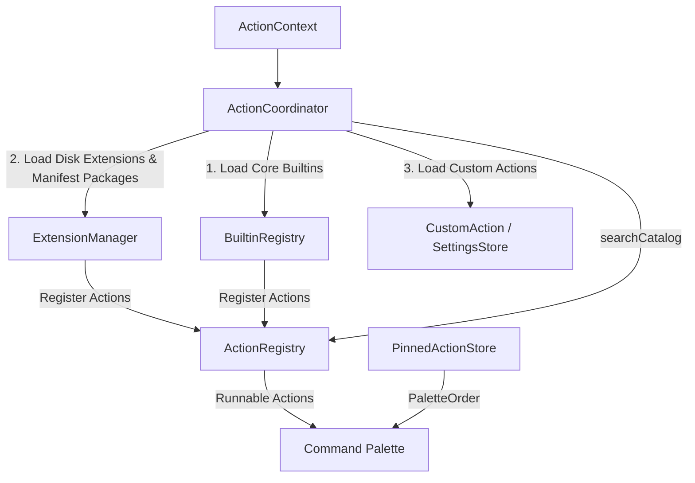

# Action Coordinator & Registry Architecture

The [`ActionCoordinator`](../../Sources/Core/Actions/ActionCoordinator.swift) serves as the **Action Coordinator & Composition** of OpenClip. It bridges domain managers (`ExtensionManager`) with the central [`ActionRegistry`](../../Sources/Core/Actions/ActionRegistry.swift) catalog, and exposes the palette's search catalog, filtered by user configuration and the current selection context.

---

## Architectural Responsibilities



1. **Composition Seam**: Initializes domain registries during `loadInitialState()`.
2. **Catalog Storage**: Delegates raw action storage to `ActionRegistry`, which keeps registration order.
3. **Policy Context**: App policies are resolved by the trigger sites (`RuleEngine.resolvePolicies`) and attached to the selection context; delivery re-reads them from the snapshot (paste-vs-copy).
4. **Custom Actions**: Loads, saves, duplicates and deletes the user's own actions.

---

## Action Registration Mechanics

> **Current reality (2026-08):** the `onRegister`/`onUnregister` callback seam described below is implemented. `ActionCoordinator.loadInitialState()` wires `ExtensionManager` to the registry via those callbacks; the manager never calls `ActionRegistry.shared` directly. GUI-authored custom actions are single-action manifest packages (written by `CustomActionManifestWriter`) and load through the same extension scan — `custom_actions.json`/`CustomActionManager` are retired.

### Initial Loading Lifecycle

```swift
@MainActor
public func loadInitialState(
    extensionsDirectory: URL = Constants.extensionsDirectory,
    dictionaryLookup: @escaping @Sendable (String) -> String? = { _ in nil }
) async {
    // Wire the extension manager to the registry through callbacks.
    extensionManager.onRegister = { [registry] action in registry.register(action: action) }
    extensionManager.onUnregister = { [registry] actionID in registry.unregister(actionID: actionID) }

    // 1. Core builtins (Search, Calculate, Define, Calendar)
    let coreBuiltins = BuiltinRegistry.makeCoreBuiltins(
        settingsStore: settingsStore,
        dictionaryLookup: dictionaryLookup
    )
    registry.register(builtIns: coreBuiltins)

    // 2. Disk extensions (manifests, standalone scripts, snippets)
    await extensionManager.loadExtensions(from: extensionsDirectory)

    // 3. First-class custom actions
    loadCustomActions()
}
```

App policies are not loaded here: `RuleEngine` resolves them from the built-in `DefaultAppRules`
catalog when the hotkey reads the selection (see [Text Selection](text-selection.md)).

### Registration & Unregistration
When extension packages are added, updated, or removed:
- `ExtensionManager.loadExtensions()` unregisters previous extension actions and reports newly discovered ones through the `onRegister`/`onUnregister` callbacks (wired to the registry by `ActionCoordinator.loadInitialState()`).
- Neither Core domain manager touches `ActionRegistry.shared` directly; `ActionCoordinator` is the only type that does.

---

## Action Registry & Palette Order

The [`ActionRegistry`](../../Sources/Core/Actions/ActionRegistry.swift) keeps the registered
actions in **registration order** — built-ins, then extensions in manifest order, then custom
actions — and applies no user order. There is no manual ordering of the whole catalog and there
are no user-defined groups.

The palette orders its own rows with [`PaletteOrder`](../../Sources/Core/Actions/PinnedActionStore.swift)
when it builds its search index (`PopupSearchView.buildIndex`):

1. **Pinned** actions first, in the order the user dragged them into on Settings › Palette
   ([`PinnedActionStore`](../../Sources/Core/Actions/PinnedActionStore.swift), `SettingKey.pinnedActionIDs`,
   at most `PinnedActionStore.limit` = 10).
2. Then by **usage recency** (`ActionUsageStore`), most recent first.
3. Then by **title**.

That is the order of an empty query. A typed query is ranked by match quality in `ActionSearch`;
recency and then this order only break ties.

Pins are stored as written, even for an action that is not registered right now (an extension
mid-reload). Every pin edit rewrites the list from the ids that exist, so a stale pin is dropped
the next time the user changes the pins, never while an action is only briefly missing; a missing
pin does not count towards the limit. Deleting a custom action or an AI preset unpins it.

---

## Action Availability: the Search Catalog

`ActionCoordinator.searchCatalog(for:)` forwards to `ActionRegistry.searchCatalog(for:)`, which
returns what the command palette may offer for an `ActionContext`, in registry order (the palette
then orders it with `PaletteOrder` and ranks it against the query with `ActionSearch`):

1. **Never listed**: `chrome.launchesAI` launchers (AI Tools) and `GatedExtensionAction`s (packages
   not yet trusted).
2. **Switched off in settings**: `SettingKey.disabledActionIDs` (per action) and
   `SettingKey.disabledPackages` (whole extension package).
3. **Hidden groups**: a group row (an extension's `.showSubActions` row or the AI launcher) that is
   switched off hides its members — by id prefix for extension groups, by `groupMembership()` for
   AI presets.
4. **Context**: `canPerform` drops actions whose `isEnabled(for:)` fails (no text, regex / app /
   expression gates, an AI preset toggled off) and actions with `chrome.requiresLiveSelection`
   (extensions declaring `input: "liveSelection"`) when the input is not a live selection
   (`SelectionSource.clipboard`).
